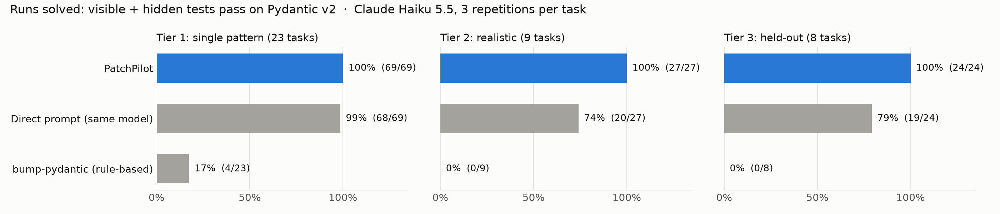
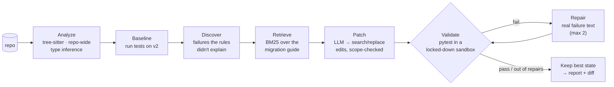

<div align="center">

# PatchPilot

### An AI code-migration agent that doesn't trust its own LLM

Repository analysis (tree-sitter) · documentation retrieval (BM25) · scoped search/replace patches ·
tests in a locked-down Docker sandbox · repair from real test failures

[](https://github.com/thrisha432/patchpilot/actions/workflows/ci.yml)


[](LICENSE)

[Results](#results) · [How it works](#how-it-works) · [What the benchmark found](#what-the-benchmark-found) · [Quick start](#quick-start) · [Docs](#documentation)

</div>

---

PatchPilot migrates a Python repository to a new library version. The first
migration it supports is **Pydantic v1 → v2**. It finds the outdated code,
retrieves the relevant section of the official migration guide, asks an LLM
for small targeted edits, runs the repository's own tests in a sandbox, and
repairs what the tests show is still broken.

The design rule: **the LLM proposes, the system verifies.** The model never
chooses what runs next. It never touches the original repository or edits
tests, and it cannot change code that no finding or failing test points to.
A change only counts once the tests pass on the new version.

<p align="center">
  
</p>

## Results

A 40-task benchmark. Every task has visible tests, **hidden tests** that only
the evaluator runs, and a hand-written reference solution. All three systems
below use **Claude Haiku 5.5** (except the rule-based tool), with 3
repetitions per task:

| | PatchPilot | Direct prompt, same model | bump-pydantic |
|---|---|---|---|
| **Tier 3: held-out tasks** (written after the code was frozen, run once) | **24/24 (100%)** | 19/24 (79%) | 0/8 |
| Tier 2: realistic tasks | **27/27 (100%)** | 20/27 (74%) | 0/9 |
| Tier 1: single-pattern tasks | 69/69 (100%) | 68/69 (99%) | 4/23 |
| **Regressions** (looked done, hidden tests caught broken behavior) | **0** | 4 | 0 |
| Lines changed vs. reference solution (all tiers) | **+1%** | +27% | n/a |

* **A stronger model doesn't close the gap.** With **Claude Sonnet 5.5** on
  tiers 2–3, PatchPilot still solved 51/51 and the direct prompt 43/51 (84%),
  failing in the same structural ways. **PatchPilot on Haiku beats the direct
  prompt on Sonnet** at about a sixth of the cost per task.
* **Repair is the biggest factor:** without it, PatchPilot solves 63% of the
  hard tasks instead of 100%. All 19 runs that needed a repair passed after
  it.
* **It found and fixed code it had no rules for.** Pydantic *dataclasses*
  were solved through test-driven discovery: the failing baseline test
  located the code.
* **The honest caveats:** on easy tasks a plain prompt does just as well. I
  wrote the synthetic tasks myself. Only 5 hard tasks separate the systems:
  PatchPilot was never worse on any run (12–0 on Haiku, p = 0.0005 at run
  level), but a conservative task-level test gives p = 0.06.
  [Uncertainty](docs/BENCHMARK_REPORT.md#how-sure-are-these-numbers) and
  [limitations](docs/BENCHMARK_REPORT.md#limitations-read-these-before-quoting-a-number)
  are in the report.

### On real open-source repositories

Three projects whose maintainers migrated to v2, scored SWE-bench style
against the **maintainers' post-migration tests**, which no system sees
(Haiku 5.5, 3 repetitions):

| | PatchPilot | Direct prompt | Direct + syntax guard | bump-pydantic |
|---|---|---|---|---|
| API client SDK (113 tests) | **3/3** | 0/3 | 3/3 | 1/1 |
| FastAPI service (28 tests) | **3/3** | 0/3 | 2/3 | 1/1 |
| Library built on Pydantic internals (API redesign) | 0/3 | 0/3 | 0/3 | 0/1 |

* PatchPilot's diffs were smaller than the maintainers', and it never
  touched a file they didn't. The direct prompt broke files that had no
  Pydantic code at all.
* **Unflattering, and reported anyway:** with a one-line "keep the file if
  the answer doesn't parse" guard, the direct prompt nearly matches
  PatchPilot. bump-pydantic matches it on these mechanical migrations. No
  system can do an API redesign. PatchPilot took 19 minutes on the service,
  mostly running its tests.
* The evaluation also found a bug in PatchPilot's best-state selection,
  which is now fixed and has a regression test.
  [Details](docs/BENCHMARK_REPORT.md#real-repositories).

### The analyzer on 551,000 lines of real code

It was run on seven major projects at their last Pydantic v1 release:
FastAPI, SQLModel, Beanie, Prefect, Netflix Dispatch, spaCy and AWS Lambda
Powertools. That is **4,400 files in 6.7 seconds, with 0 crashes.**

* **Precision on held-out projects: 57/57 actionable findings correct**
  (95% interval 93.7–100%). Every finding was labelled by hand.
* **The first run found real bugs, now fixed and tested.** It crashed on
  Prefect, and it confused same-named classes across modules. It also
  suggested renames that would break custom `.dict()` overrides. One fix
  is confirmed by the maintainers' own migration.
  [Details](docs/BENCHMARK_REPORT.md#the-analyzer-on-large-real-codebases).

Full method, every table, and per-task results:
[**docs/BENCHMARK_REPORT.md**](docs/BENCHMARK_REPORT.md).

## How it works



| Stage | What makes it trustworthy |
|---|---|
| **Analyze** | Two passes over the whole repository. Model classes resolve across files, and receiver types are inferred from annotations, assignments, return types, fields and loops, so `user.dict()` (a model) is fixed while `response.json()` (an HTTP client) is left alone. Every finding has a confidence level, and only HIGH and MEDIUM ones are auto-fixed. |
| **Discover** | The repo's tests run on v2 *before* any change. Failures that the rules didn't explain become findings. This catches behavior changes no deprecated API reveals, like v2 rejecting `3.7` for an `int` field. |
| **Retrieve** | Okapi BM25, written from scratch, over the official guide, with a code-aware tokenizer (`orm_mode` → `orm_mode`, `orm`, `mode`). Queries are built from each finding. Labeled recall@3 is tested. |
| **Patch** | One LLM call per file, returning JSON search/replace edits instead of diffs. An edit applies only if its text matches **exactly once** and lands inside a finding's span or the imports. Whole-file rewrites are refused. |
| **Validate** | Docker with `--network none`, a read-only filesystem, no capabilities, a non-root user, CPU/memory/PID limits and a timeout kill. It sees no host environment variables (so no API keys). **Pydantic deprecation warnings are errors**, so "it still runs through v2's compatibility shims" doesn't count. |
| **Repair** | The failing tests' tracebacks go back to the model. The repair scope widens to what the failing tests implicate, and nothing else. The **best state seen** is kept. If nothing beats the original, the original is restored. |
| **Workspace** | A git-tracked copy of the repo, so the original is never modified. Tests are write-protected. `--apply` writes back only after validation passes, and only if the original hasn't changed meanwhile. |

Design decisions and trade-offs: [docs/ARCHITECTURE.md](docs/ARCHITECTURE.md).

## What the benchmark found

**1. The first harder benchmark tier showed my design was too strict.**
v0.1 solved 12/27 realistic tasks, *fewer* than the direct prompt (20/27).
Every failure had one cause: PatchPilot only edited where its analyzer
pointed. When a failing test pointed somewhere else, my own scope guard
rejected the fix. v0.2 lets test evidence widen the repair scope (exactly
what failing tests implicate, nothing more), and it closes four analyzer
gaps the failures exposed. Result: 27/27. Because that was fixed *after*
seeing those tasks, I then wrote a **held-out tier**, froze the code, and ran
it once: 24/24. [Details](docs/BENCHMARK_REPORT.md#v01--v02-what-the-benchmark-changed)

**2. The direct prompt fails in two structural ways.** It renames look-alike
methods on classes that aren't Pydantic models (`AuditLog.copy()` →
`.model_copy()`): from one file in isolation, they look identical. And it
can't see behavior changes, like `Decimal` becoming a JSON string or ints no
longer coercing to `str`, because it never runs the code. In 4 runs its
change passed the visible tests and still broke behavior.

**3. Easy benchmarks prove nothing.** On 23 single-pattern tasks, every LLM
system scored ~100%. The first benchmark I built couldn't tell the systems
apart, so I built harder tiers rather than report a meaningless 100%.

**4. The official codemod solves 4/40, by design.** bump-pydantic doesn't
rewrite method calls like `.dict()`, because without type information it
can't know what the receiver is. That's the gap repo-wide receiver inference
closes.

## A real report (excerpt)

<details>
<summary><b><code>patchpilot migrate</code> on task 01, Claude Haiku 5.5: 1 LLM call, 6.8 s</b></summary>

```text
ANALYZE    3 files, 2 findings
BASELINE   0 passed, 1 failed
RETRIEVE   6 doc hits
PATCH      3 edits applied, 0 rejected
VALIDATE   1 passed, 0 failed
RESIDUAL   0 findings remain
✅ Validation passed
```

- line 22, applied. The V1 nested `class Config` is deprecated. In V2, config is set via
  `model_config`/`ConfigDict`, and `orm_mode` becomes `from_attributes`.
  - Docs: Migration guide > Changes to config
- line 26, applied. `from_orm()` is deprecated in V2; `model_validate` replaces it when
  `from_attributes=True` is set.
  - Docs: Migration guide > Changes to `pydantic.BaseModel`

```diff
-from pydantic import BaseModel
+from pydantic import BaseModel, ConfigDict
@@
-    class Config:
-        orm_mode = True
+    model_config = ConfigDict(from_attributes=True)
@@
-    return User.from_orm(row)
+    return User.model_validate(row)
```

The model's own notes ended with *"I did not run the code or tests."* That's
the reason PatchPilot does.

</details>

## Quick start

**Prerequisites:** Python 3.12+, Docker, and one LLM provider:

* **Claude** via the [Claude Code](https://claude.com/claude-code) CLI
  (uses your Claude subscription; no API key needed), or
* **Gemini** with a [free API key](https://aistudio.google.com/apikey) in
  `.env` (copy `.env.example`).

```bash
git clone https://github.com/thrisha432/patchpilot.git && cd patchpilot
python -m venv .venv && .venv/bin/pip install -e '.[dev]'
.venv/bin/patchpilot sandbox build          # two small images: Pydantic v1 and v2
.venv/bin/patchpilot doctor                 # checks Docker, images, provider key

# Analyze only (no LLM, no changes)
.venv/bin/patchpilot analyze benchmarks/tasks/21-service-layer/repo

# Migrate in an isolated workspace, validate, and write a report
cp -r benchmarks/tasks/21-service-layer/repo /tmp/demo
.venv/bin/patchpilot migrate /tmp/demo --model claude-code:claude-haiku-5-5 --report report.md
#   --model gemini:gemini-2.5-flash    to use Gemini instead
#   --apply                            to write the result back (only if tests pass)
```

Other commands: `patchpilot docs "orm_mode"` (search the migration guide)
and `patchpilot serve` (HTTP API on 127.0.0.1:8765: `POST /v1/migrations`,
then `GET /v1/migrations/{id}`, `/report.md`, and `/diff`).

### Verify everything yourself

```bash
.venv/bin/pytest                                  # 96 tests (Docker tests need the sandbox images)
.venv/bin/ruff check . && .venv/bin/mypy          # lint + strict types
.venv/bin/python benchmarks/validate_tasks.py     # 40/40 tasks valid
.venv/bin/python benchmarks/run_benchmark.py --model claude-code:claude-haiku-5-5 --reps 3
.venv/bin/python benchmarks/summarize.py benchmarks/results/v0.2/*.jsonl --tier 3
```

## Project layout

```text
src/patchpilot/
  analyzer/       scanner, tree-sitter wrapper, analysis entry point
  profiles/       migration profiles; pydantic_v2/ = detector + vendored official guide
  retrieval/      Markdown chunker, BM25 (from scratch), retriever
  llm/            provider interface: Claude Code, Gemini, scripted (tests), on-disk cache
  migration/      orchestrator (state machine), edits, workspace, discovery, repair scope
  validation/     syntax check + Docker sandbox runner
  reporting/      Markdown / JSON reports
  bench/          benchmark tasks, systems under test, scoring
  api/ cli.py     FastAPI job API, Typer CLI
benchmarks/       40 tasks (repo + hidden tests + reference), runner, summaries, raw results
sandbox/          Dockerfile for the test sandbox
tests/            unit + integration (incl. attacks on the sandbox)
```

## Documentation

| Document | Contents |
|---|---|
| [Benchmark report](docs/BENCHMARK_REPORT.md) | Method, tiers, all results, failure analysis, v0.1 → v0.2, limitations |
| [Architecture](docs/ARCHITECTURE.md) | Every stage, with design decisions and trade-offs |
| [Security](docs/SECURITY.md) | Threat model and the test that covers each mitigation |
| [Changelog](CHANGELOG.md) | What changed between versions, and why |

## Limitations

* One migration profile (Pydantic v1 → v2). The pipeline is library-agnostic:
  a profile supplies the detector, the guide, the sandbox images and the
  pytest flags.
* Validation is only as good as the repository's tests. Without tests, the
  result is reported as *unverified*.
* The sandbox images come with the target library preinstalled, and there is
  no network at test time. Other dependencies have to be added to the image.
* Type inference is syntactic and local. Receivers it can't resolve are
  reported for human review, never auto-fixed.
* Pydantic imported through a project's own re-export module (for example,
  LangChain's `langchain.pydantic_v1`) is not followed.

> This is a portfolio project, not production-certified tooling. Code sent to
> a hosted model leaves your machine. With Gemini's free tier, Google may use
> it, so only use public or sample code there.

## License

MIT. See [LICENSE](LICENSE). The vendored Pydantic migration guide is MIT
licensed by the Pydantic authors
([`LICENSE-pydantic`](src/patchpilot/profiles/pydantic_v2/guides/LICENSE-pydantic)).
