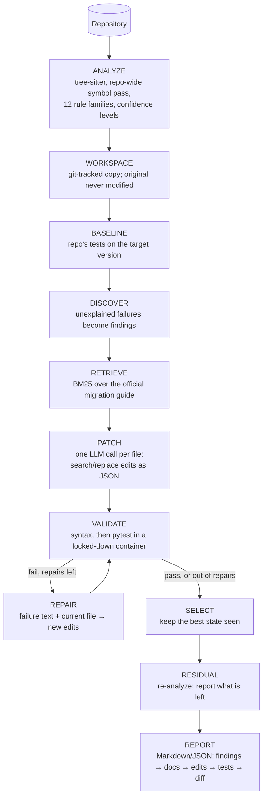

# PatchPilot architecture

PatchPilot migrates a Python repository from one library version to another
(first profile: Pydantic v1 → v2). Its design rule: **the LLM proposes, the
system verifies.** The model never decides what runs next, never touches the
original repository, never edits tests, and its output only counts once the
repository's own tests pass on the target version.

## Pipeline

The orchestrator (`migration/orchestrator.py`) is a plain loop with named
states, not an agent framework. Every transition is recorded with its timing
in the report, so a run can be replayed and audited step by step.

## Components

### Repository analyzer (`analyzer/`, `profiles/pydantic_v2/detector.py`)

Two passes, both on tree-sitter syntax trees. tree-sitter is used instead of
the stdlib `ast` because it is error-tolerant: a file that does not fully
parse still yields a tree, so one syntax error does not hide the rest.

1. **Symbols.** For every file: `pydantic` imports with their aliases,
   classes with their bases, model field annotations, function return
   annotations. Model classes are then resolved to a fixed point, so a class
   that inherits from a model defined in another file is also a model.
2. **Rules.** Each file is walked once with that repository-wide context.

The hard part is method calls. `x.dict()` must become `x.model_dump()` when
`x` is a Pydantic model, and must be left alone when `x` is anything else.
`resp.json()` on an HTTP response is the classic false positive. The analyzer
infers the receiver's type from:

| Evidence | Example |
|---|---|
| A model class itself | `User.parse_obj(d)` |
| `self` / `cls` inside a model | `self.dict()` |
| An annotated parameter | `def f(u: User): u.json()` |
| An assignment from a model-returning expression | `u = User.from_orm(r)` |
| A function's return annotation, across files | `load_user().dict()` |
| A model field's annotation | `order.customer.json()` |
| A loop or comprehension over `List[Model]` | `[r.dict() for r in rows]` |
| A parametrized generic | `Page[Item].parse_obj(...)` |

Receivers that are provably *not* models (literals, parameters annotated with
a non-model class from the repository) are skipped. Each finding carries a
**confidence**: HIGH and MEDIUM findings go to the LLM, while LOW findings
(nothing tells us what `x` is) are reported for human review and never
auto-fixed. Test files are parsed for context but never become targets.

The analyzer also defines each finding's **span**: the construct a fix may
touch (the whole decorated validator, the whole `class Config`, the
statement containing a call). Spans drive the edit scope guard below.

### Test-driven discovery (`migration/discovery.py`)

Static rules only see APIs that changed. Some migrations change *behavior*
with no API change at all: Pydantic v2 rejects `3.7` for an `int` field,
which v1 silently truncated. The baseline run of the repository's own tests on
the target version catches this. If a failure's traceback ends in repository
code that no static finding covers, that location becomes a `test-failure`
finding. It then goes through retrieval and patching like any other finding,
and its query is built from the error text, so it retrieves *"Type conversion
from floats to integers"*.

### Documentation retrieval (`retrieval/`)

* **Corpus:** the official Pydantic migration guide (MIT licensed, vendored
  in the profile), chunked by heading. `#` lines inside code fences are code
  comments, not headings. Long sections split at list-item or paragraph
  boundaries, never inside a code block.
* **Ranking:** Okapi BM25, implemented from scratch. The tokenizer is
  code-aware: `orm_mode` → `orm_mode`, `orm`, `mode`; `BaseModel` →
  `basemodel`, `base`, `model`. An exact identifier match scores highest,
  while related words still connect. Plurals fold, so the error text's
  "integer" meets the guide's "integers".
* **Why not embeddings:** a focused corpus of about 40 sections, with queries
  dominated by exact identifiers, is what lexical retrieval is good at. BM25
  needs no model and no vector store, and it is deterministic and explainable.
* **Queries** are built from the finding itself (its identifiers, title, and
  message), not hand-written per rule. A labeled test checks recall@3 on 10
  cases (`tests/unit/test_retrieval.py`).
* **Context budget:** per file, the chosen chunks are deduplicated and taken
  round-robin across findings (each finding's best chunk first), within a
  character budget, so one finding cannot crowd out the others.

### LLM layer (`llm/`)

One interface: `generate(system, prompt, schema) -> text + usage`. Providers:

| Provider | Use |
|---|---|
| `ClaudeCodeProvider` | Claude models through the Claude Code CLI's headless mode, under a Claude subscription. Tool-less, session-less, run in an empty directory. `ANTHROPIC_API_KEY` is stripped from its environment so it can never bill an API account by accident. |
| `GeminiProvider` | Google Gemini over HTTPS (free tier). Client-side rate limiter; honours `retryDelay`; a daily-quota error stops the run instead of retrying or switching to a paid model. The key goes in a header, never the URL. |
| `ScriptedProvider` | Deterministic test double: the test suite makes no network calls. |
| `CachingProvider` | Wraps any provider with an on-disk cache (atomic writes). A benchmark re-run replays identical answers and spends no quota. |

Answers are structured JSON, validated with Pydantic, with one retry on
malformed output.

### Edits, not diffs (`migration/edits.py`)

The model returns **search/replace** edits. LLMs routinely get unified-diff
line numbers and hunk headers wrong, and a diff that "applies with fuzz" can
land in the wrong place. An exact-text anchor cannot. The rules:

* `search` must match **exactly once**. Zero or several matches means the
  edit is rejected, and the reason goes to the repair step.
* Tolerated: trailing whitespace, and a uniform indentation shift, which is
  re-applied to the replacement. Every tolerated match is recorded.
* **Scope guard:** the matched region must overlap a finding's span (±2
  lines), mapped through earlier edits with a line diff, or the import block.
  Edits anywhere else are rejected as *out of scope*.
* **Size guard:** no edit may replace more than 60% of a file (whole-file
  rewrites are how unrelated code gets changed).
* The model never names files. Each call is about one file, so it cannot
  touch others.

### Workspace (`migration/workspace.py`)

A copy of the repository with its own git history: one commit for the
baseline and one per patch round. This gives three guarantees:

1. **The original is never modified during a run.**
2. "Restore the last known-good version" is a checkout.
3. The final diff is `git diff baseline`.

The copy skips virtualenvs and caches, copies symlinks as links (so nothing
outside the repository is pulled in), refuses paths that escape the
workspace, and **refuses to write test files**: an agent that may edit the
tests can "pass" by weakening them. Git runs with the user's global config
ignored, so hooks and commit signing cannot interfere. Writing back to the
original (`--apply`) happens only after validation passes, and only if every
file still has the hash it had when the run started.

### Validation (`validation/runner.py`)

1. **Syntax:** `compile()` on the host. It parses only and never executes.
2. **Tests:** pytest in a Docker container built for the target environment.
   The repository is untrusted code, and so is LLM output:
   * `--network none`, `--cap-drop ALL`, `no-new-privileges`;
   * read-only root filesystem, workspace mounted read-only, small `tmpfs`
     for `/tmp`, and only `/out` (the JUnit report) writable;
   * memory, CPU, and process-count limits, plus a wall-clock timeout that
     kills the container;
   * a non-root user and no host environment variables, so no API keys.

   `tests/integration/test_sandbox.py` attacks each of these from inside the
   container.
3. **Deprecations are errors:** pytest runs with
   `-W error::pydantic.warnings.PydanticDeprecatedSince20`. Pydantic v2 still
   *runs* most v1 code through compatibility shims. Without this flag,
   "tests pass" would not mean "migrated".

### Repair and selection

When validation fails, each file gets a failure context: its rejected edits
(with reasons), its syntax errors, and the failing tests' tracebacks, trimmed
to a budget. Files named in a traceback are repaired. If none is named, every
target file is. The repair prompt includes the **current** content (the
earlier edits are kept) and asks for new edits against it. There are at most
2 repairs.

Selection keeps the **best state seen**, scored as (parses, tests passed,
−tests failed), not the last one. A repair that makes things worse is rolled
back. If nothing beats the original, the original is restored.

### Interfaces

* **CLI** (`patchpilot analyze | migrate | docs | doctor | sandbox build | serve`).
* **HTTP API** (FastAPI): submit a job, poll its states, then fetch the
  report and the diff. Jobs run serially on one worker thread, and the job
  table is bounded. Repository paths must be under an allowed root. The API
  never writes to the original repository: it returns a diff for a human to
  review.

## Design decisions in one place

| Decision | Alternative | Why |
|---|---|---|
| Explicit state machine | Agent framework (LangGraph), multi-agent | Every step is testable with a scripted model. The LLM cannot loop, skip validation, or choose tools. |
| One LLM call per file | Whole repository in one prompt | Bounded context, and a failure stays local to one file. Cross-file context goes in a short repository note (model classes, files being migrated). |
| Search/replace edits | Unified diffs, whole files | Exact anchors cannot land in the wrong place. Rejections are explainable and feed the repair step. |
| BM25 from scratch | Embeddings + vector DB | Identifier-heavy queries on a small corpus. Deterministic, no model. |
| Tests are read-only | Let the agent fix tests too | Otherwise "tests pass" can be achieved by weakening tests. |
| Keep the best state | Keep the last state | A bad repair should not destroy a good earlier round. |
| Deprecations as errors | Plain pytest | Otherwise compatibility shims make unmigrated code look migrated. |
| Confidence levels | Fix every name match | `resp.json()` on an HTTP client must not change. |

## Limitations

* Type inference is local and syntactic: no data flow across arbitrary
  assignments, no imports of third-party stubs. Unknown receivers are LOW
  confidence and are reported rather than fixed.
* Validation is only as good as the repository's tests. With no tests, the
  result is reported as *unverified*.
* Sandbox images are built ahead of time with the target library
  preinstalled. Projects with other dependencies need those added to the
  image (there is no network at test time).
* One profile so far (Pydantic v1 → v2). A profile supplies the detector,
  the guide, the images, and the pytest flags. The pipeline itself is
  library-agnostic.
