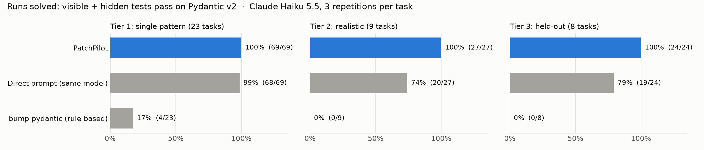
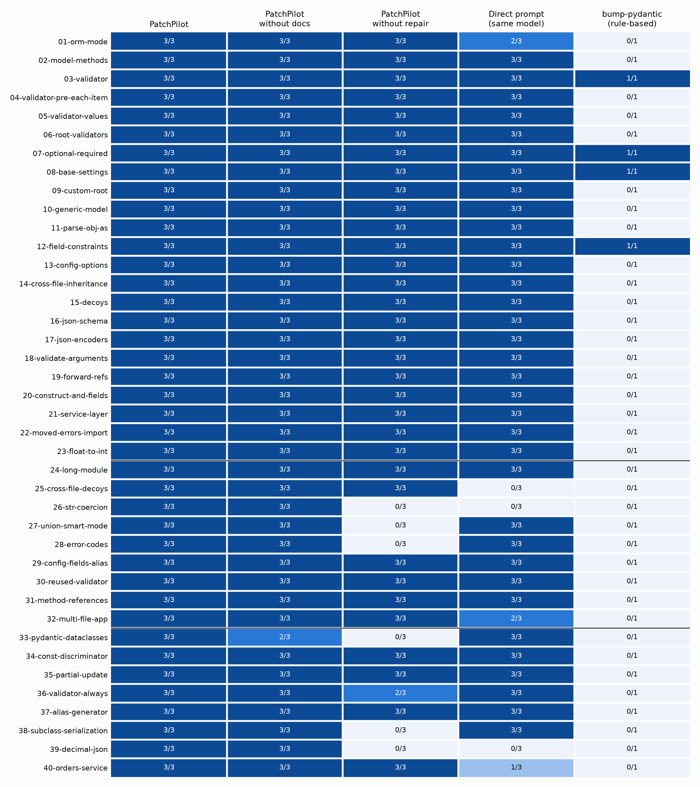

# Benchmark report

**Question:** does PatchPilot's architecture (analysis, retrieval, scoped
edits, sandboxed validation, repair) migrate code more reliably than giving
the same model the file and asking it to migrate?

**Short answer, with Claude Haiku 5.5:** on easy single-pattern tasks, no.
Both solve nearly everything. On realistic tasks, yes:

* on the **held-out** set (written after the code was frozen, run once),
  PatchPilot solved **24/24** runs versus **19/24** for the direct prompt;
* PatchPilot **never** broke code outside the migration: 0 regressions and
  0 collateral files across all 120 runs (360 including the ablations).
  The direct prompt did both, on exactly the tasks designed to catch it.
* With **Claude Sonnet 5.5** the direct prompt improves only slightly
  (76% → 84% on tiers 2–3) and fails the same way, while PatchPilot stays
  at 100%.

All numbers below come from `benchmarks/results/` and can be regenerated
(see [Reproducing](#reproducing)).

## Method

### Tasks: 40, in three tiers

| Tier | Tasks | What they are | When written |
|---|---|---|---|
| 1 | 23 | One or two Pydantic v1 patterns each, in small projects (`01`–`23`) | before any system ran |
| 2 | 9 | Realistic: a 240-line module, look-alike non-Pydantic classes across files, behavior changes with no deprecated API (int→str coercion, smart unions, changed error messages), uncommon syntax (validators without `@`, methods passed by reference), a six-file app (`24`–`32`) | after tier-1 results, **before** any system ran on them |
| 3 | 8 | **Held-out:** Pydantic dataclasses, `const` discriminators, PATCH semantics, `always=True` validators, alias generators, subclass serialization, `Decimal` JSON output, a multi-file service with decoys (`33`–`40`) | **after PatchPilot v0.2 was frozen**; run once |

Each task has the v1 project, visible tests (which systems may run), hidden
tests (which only the evaluator runs), and a hand-written v2 reference
solution. `benchmarks/validate_tasks.py` checks every task before any result
on it is trusted:

1. the original passes all tests on Pydantic v1 (the task's code is correct);
2. the original **fails** on Pydantic v2 (the migration is necessary);
3. the reference solution passes all tests on v2 (the task is solvable).

All 40 tasks pass all three checks. The analyzer reports 0 findings on every
reference solution, so it raises no false positives on correct v2 code.

### Systems

| System | Description |
|---|---|
| **PatchPilot** | the full pipeline (see [ARCHITECTURE.md](ARCHITECTURE.md)) |
| PatchPilot without docs | ablation: no retrieved documentation in prompts |
| PatchPilot without repair | ablation: one patch round, no repairs |
| **Direct prompt** | the same model receives each source file with "migrate this file" and returns the whole file, which is applied as-is: no analysis, no docs, no tests. What a developer gets from a chat window. |
| bump-pydantic | Pydantic's official rule-based codemod (no LLM) |

The model is **Claude Haiku 5.5** (`claude-haiku-5-5`), called through Claude
Code's headless mode. A comparison with Claude Sonnet 5.5 is below. There
are **3 repetitions** per (task, system), because the CLI exposes no
temperature setting and answers vary between runs.

### Scoring (identical for every system)

* **Solved:** visible **and** hidden tests pass on Pydantic v2, with
  Pydantic's deprecation warnings turned into errors. Code that merely still
  runs through v2's v1-compatibility shims does not count.
* **Regression:** visible tests pass but hidden tests fail. The change
  *looks* done and isn't.
* **Collateral files:** files changed that the reference solution leaves
  alone.
* **Integrity:** before scoring, the original test files are restored,
  whatever the system did to them. Hidden tests are mounted read-only from
  outside the repository, so no system ever sees them. Tests run in the
  locked-down sandbox.

## Results (PatchPilot v0.2, Claude Haiku 5.5, 3 repetitions)



### Tier 3: held-out (8 tasks × 3 = 24 runs)

| System | Solved | Regressions | Collateral files | Lines changed (reference: 282) | LLM calls / task | Repairs / task |
|---|---|---|---|---|---|---|
| **PatchPilot** | **24/24 (100%)** | 0 | 0 | 275 | 1.6 | 0.46 |
| PatchPilot without docs | 23/24 (96%) | 0 | 0 | 271 | 1.7 | 0.54 |
| PatchPilot without repair | 14/24 (58%) | 0 | 0 | 192 | 1.1 | 0 |
| Direct prompt | 19/24 (79%) | **2** | 0 | 314 | 1.25 | n/a |
| bump-pydantic | 0/8 (0%) | 0 | 0 | 24 | 0 | n/a |

### Tier 2: realistic (9 tasks × 3 = 27 runs)

| System | Solved | Regressions | Collateral files | Lines changed (reference: 294) |
|---|---|---|---|---|
| **PatchPilot** | **27/27 (100%)** | 0 | 0 | 309 |
| PatchPilot without docs | 27/27 (100%) | 0 | 0 | 318 |
| PatchPilot without repair | 18/27 (67%) | 0 | 0 | 231 |
| Direct prompt | 20/27 (74%) | **2** | **2** | 416 |
| bump-pydantic | 0/9 (0%) | 0 | 0 | 61 |
| *PatchPilot v0.1 (before the fixes below)* | *12/27 (44%)* | *0* | *0* | *209* |

### Tier 1: single-pattern (23 tasks × 3 = 69 runs)

| System | Solved | Lines changed (reference: 624) |
|---|---|---|
| PatchPilot | 69/69 (100%) | 629 |
| PatchPilot without docs | 69/69 (100%) | 622 |
| PatchPilot without repair | 69/69 (100%) | 629 |
| Direct prompt | 68/69 (99%) | **798** (+28%) |
| bump-pydantic | 4/23 (17%) | 122 |

Tier 1 does not separate the LLM systems: Haiku 5.5 handles a single
deprecated pattern in a small file whichever way it is asked. That tier is
kept as a sanity check, not as evidence.



## What the failures show

**Direct prompt: two failure modes, both structural.**

1. *It renames look-alike methods on classes that are not Pydantic models.*
   `Record.dict()`, `LRU.dict()`, and `AuditLog.copy()` became
   `.model_dump()` / `.model_copy()`, which then crashed with
   `AttributeError`. Seen per file, these calls are indistinguishable from
   Pydantic calls; only another file says otherwise. In 4 runs the visible
   tests still passed, so the change looked done, and only the hidden tests
   caught it. Once, rewriting the legacy module produced invalid syntax.
2. *It cannot see behavior changes, because it never runs the code.* It
   failed every run of `26` (v2 stops coercing ints to `str` fields) and
   every run of `39` (v2 serializes `Decimal` as a JSON string).

It also rewrites more than needed: 28% more lines than the reference on
tier 1. Once (task `01`) it deleted a class that the tests import.

**PatchPilot: where the parts earn their place.**

* **Repair is the largest single factor:** 67% → 100% on tier 2 and 58% →
  100% on held-out tier 3. All 19 runs that needed a repair passed after
  it. The fixes came from real test output: a `NameError` for a missing
  import, smart-union coercion, error-message codes, `Decimal` JSON.
* **Test-driven discovery** solved task `33` (Pydantic *dataclasses*), a
  feature the analyzer has **no rules for**. The baseline failure located
  the code, and the repair loop fixed it.
* **Retrieved documentation** helps a little on this model: one failure
  without it (task `33`, a dataclass config the model got wrong once) and
  slightly smaller diffs. With a stronger model the docs matter less. They
  are the cheapest part of the pipeline to keep, and they make every edit
  explainable (each report cites the guide section behind it).
* **The analyzer + scope guard** are why there are 0 regressions and 0
  collateral changes: edits land only where findings or failing tests point,
  and receivers that are provably not models are never touched.

**bump-pydantic** solves 4/40 tasks. That is by design rather than poor
quality: it deliberately does not rewrite method calls like `.dict()`,
because without type information it cannot know whether the receiver is a
model. That is precisely the gap PatchPilot's repo-wide receiver inference
closes.

## v0.1 → v0.2: what the benchmark changed

The frozen v0.1 run on tier 2 solved only **12/27** runs, fewer than the
direct prompt (20/27). The failures had one root cause: **PatchPilot only
edited where its analyzer pointed.** When a failing test pointed somewhere
else, the scope guard rejected the fix. The changes, all general rather
than task-specific (details in [CHANGELOG.md](../CHANGELOG.md)):

| v0.1 failure | Fix in v0.2 |
|---|---|
| `28`: the fix lives in a lookup table far from any finding, so the repair was rejected as out of scope | **Test-guided repair scope:** repairs may edit lines a failing traceback names, and the definitions (plus module-level names they read) that failing tests import |
| `30`, `31`: validator without `@`, methods passed by reference, so the analyzer found nothing and nothing changed | Analyzer rules for both; **discovery** now also catches deprecation failures the rules miss |
| `32`: a `.json()` on a generic model, missed | Generic return annotations resolved (`-> Page[Item]`) |
| `25`: false positive on a non-model `Snapshot.parse_obj` | Repository classes that are not models are never flagged |

v0.2 solves 27/27 on tier 2. Because those fixes were made *after* seeing
tier 2, **tier 2 is not a fair test of v0.2.** That is what tier 3 is for:
written after v0.2 was frozen, run once, and reported above as it came out.

## Model comparison: Claude Sonnet 5.5

Does a stronger model make the architecture unnecessary? PatchPilot and the
direct prompt were re-run on tiers 2 and 3 (17 tasks × 3 repetitions) with
**Claude Sonnet 5.5** (`claude-sonnet-5-5`):

| Tiers 2 + 3 | PatchPilot | Direct prompt | Direct-prompt regressions | Est. cost per task, PatchPilot / direct |
|---|---|---|---|---|
| Claude Haiku 5.5 | **51/51 (100%)** | 39/51 (76%) | 4 | ≈ $0.002 / $0.001 |
| Claude Sonnet 5.5 | **51/51 (100%)** | 43/51 (84%) | 3 | ≈ $0.032 / $0.012 |

* The stronger model narrows the gap only slightly, and **its failures are
  the same structural ones**. It renamed `Record.dict()` (not a Pydantic
  model) in all 3 runs of `25`, renamed `LRU.copy()` once, and produced
  string `Decimal`s in all 3 runs of `39`. Those come from the method (one
  file at a time, code never run), not from the model's ability.
* **PatchPilot with the cheaper model beats the direct prompt with the
  stronger one:** 100% vs 84%, at roughly a sixth of the per-task cost.
* With Sonnet, PatchPilot's diffs match the reference size exactly (576 vs
  576 lines). The direct prompt's are 22% larger (705).

Cost estimates use list prices ($0.10/$0.50 per million input/output
tokens for Haiku 5.5, $2/$10 for Sonnet 5.5) on the recorded token counts,
ignoring cache pricing. The runs used a Claude subscription, so these are
equivalents, not money spent.

## How sure are these numbers?

The counts are small, so here they are with 95% Wilson intervals and paired
tests (`benchmarks/stats.py`). Each comparison pairs the same (task,
repetition) across the two systems:

| Claude Haiku 5.5 | PatchPilot | Direct prompt |
|---|---|---|
| Tier 2 | 27/27 (88–100%) | 20/27 (55–87%) |
| Tier 3, held-out | 24/24 (86–100%) | 19/24 (60–91%) |
| Tiers 2 + 3 | 51/51 (93–100%) | 39/51 (63–86%) |

| PatchPilot vs direct prompt | Runs only PatchPilot solved / only direct solved | p, runs (McNemar) | Tasks better / worse | p, tasks (sign test) |
|---|---|---|---|---|
| Haiku 5.5, tiers 2 + 3 | 12 / 0 | 0.0005 | 5 / 0 | 0.06 |
| Haiku 5.5, held-out only | 5 / 0 | 0.06 | 2 / 0 | 0.50 |
| Sonnet 5.5, tiers 2 + 3 | 8 / 0 | 0.008 | 4 / 0 | 0.13 |

How to read this:

* **The direction is consistent.** Across all 171 paired runs (120 on
  Haiku, 51 on Sonnet), PatchPilot never failed a run that the direct prompt
  solved.
* **The run-level test is optimistic.** Repetitions of one task are
  correlated, so they are not independent samples. The **task-level sign
  test is conservative**: one vote per task, with tasks where both systems
  tie ignored. Only 5 tasks separate the systems, so it cannot reach p < 0.05
  even with a 5–0 split. That is a limit of 17 hard tasks, not a mixed
  result.
* **The held-out tier alone is suggestive, not significant.** Its value is
  that it was written after the code was frozen. Its size is too small to
  prove a difference by itself.
* More hard tasks would tighten every interval here. The
  [real-repository evaluation](#real-repositories) adds tasks no one designed
  for PatchPilot.

## Real repositories

The synthetic tasks were written by PatchPilot's author. This evaluation
uses three open-source projects whose **maintainers** migrated them to
Pydantic v2 (`benchmarks/real/*.toml`, `benchmarks/run_real.py`):

| Project | What it is | Required tests | Base code passes on v2 | Maintainers' diff |
|---|---|---|---|---|
| `ciscosupportsdk` | API client SDK | 113 | 13 | 29 lines |
| `okdata-permission-api` | FastAPI + Keycloak service | 28 | 0 | 74 lines |
| `pydantic-cli` | library built on Pydantic internals | 33 | 0 | 535 lines (API redesign) |

**Scoring, modelled on SWE-bench.** Each system gets the repository at the
last commit before the migration, with its tests as they were then. Scoring
then swaps in the maintainers' **post-migration test suite**, which no
system ever sees. The required tests are the ones that pass on the
maintainers' own migrated code. A run succeeds only if all of them pass on
Pydantic v2, with deprecations raised by the package's own modules counted
as errors. `pydantic-cli` is the exception: its maintainers changed the
public API, so their new tests don't apply to the old code. There, the
required tests are the base tests that passed on v1. A fourth candidate,
`pydantic-avro`, was excluded because its new tests import a symbol that
only the maintainers' redesign adds.

Every task is re-validated before each run (`results/real/validity.json`).
Claude Haiku 5.5, 3 repetitions (bump-pydantic is deterministic, so it ran
once):

| | PatchPilot | Direct prompt | Direct prompt + syntax guard | bump-pydantic |
|---|---|---|---|---|
| `ciscosupportsdk` | **3/3** | 0/3 | 3/3 | 1/1 |
| `okdata-permission-api` | **3/3** | 0/3 | 2/3 | 1/1 |
| `pydantic-cli` | 0/3 | 0/3 (best run 24/33 tests) | 0/3 (best 24/33) | 0/1 |
| Lines changed, first two projects (maintainers: 29 + 74) | **15 + 54–56** | 54–117 + 85–147 | 46–115 + 74–122 | 17 + 34 |
| Files changed that the maintainers didn't touch | **0** | 1–7 | 0–5 | 0 |
| LLM calls per run (first two projects) | 3 + 21 | 29 + 33 | 29 + 33 | 0 |

What this shows, including where it is unflattering:

* **The plain direct prompt fails on real code because it rewrites
  everything.** It sends every source file, including ones with no Pydantic
  code at all. For several of those, Haiku put an explanation ("no changes
  are needed…") into the file field, and the file stopped parsing. That
  happened in all six runs.
* **A one-line syntax guard closes most of the gap.** The *guarded* variant
  reuses the same cached answers but keeps the original file whenever an
  answer does not parse. It solved 5 of 6 runs on the first two projects,
  against PatchPilot's 6 of 6. On real code, **most of the direct prompt's
  failures were "wrote non-code"**, not "migrated wrongly". I added this
  variant because without it, the comparison would have been against a
  strawman.
* **What still separates them is precision.** PatchPilot changed only files
  the maintainers also changed, with diffs smaller than the maintainers'.
  The guarded prompt edited up to 5 extra files per run, and its diffs
  varied by 2.5× between repetitions of the same task.
* **bump-pydantic matched PatchPilot on the first two projects.** Their
  migrations were mostly mechanical (`Config` classes, `.dict()`,
  validators), which is exactly what a rule-based codemod is for, and it
  needs no model. These three projects do not show PatchPilot beating the
  official tool. The synthetic tiers 2–3, where bump-pydantic solved 0/17
  tasks, contain the patterns it can't handle.
* **No system migrated `pydantic-cli`.** It reads Pydantic internals that v2
  removed (`ModelField`, `field_info.extra`, the model's `Config` class), so its maintainers
  rewrote 535 lines and changed the API. PatchPilot completes the mechanical
  part (0 residual findings) but cannot do the redesign: its edits are
  confined to findings and failing tests by construction. That is a real
  limit of the design, not a tuning issue.
* **PatchPilot is slow on large test suites.** It took about 19 minutes on
  `okdata-permission-api`, almost all of it running the test suite in Docker
  (baseline, patch and two repairs), against about 4 minutes for the direct
  prompt.

**A bug this evaluation found.** In the first run, PatchPilot changed 0
lines on `pydantic-cli`, even though every edit applied. Its "keep the best
state" step scored states by (parses, tests passed, −tests failed). The
patch fixed the imports of 15 test modules that had failed to load, and
their tests then failed one by one: 15 collection errors became 26 test
failures. The scorer read that as a regression and restored the untouched
code. Collection errors now rank worse than any number of individual
failures (`ValidationResult.score`, with a regression test). The
superseded rows are kept in
`results/real/superseded-pydantic-cli-patchpilot-v0.2.0.jsonl`. The fix
cannot change any successful run, because a passing state always scores
highest.

## Cost and time

| | PatchPilot | Direct prompt |
|---|---|---|
| LLM calls per task (tier 3) | 1.6 | 1.25 |
| Tokens per task (tier 3) | ~10.7k | ~3.1k |
| Equivalent API cost per task at Haiku 5.5 list price | ≈ $0.002 | ≈ $0.0007 |
| Model time per task (tier 3) | 11.4 s | 5.7 s |
| Docker validation per run | ~0.5 s per test run | none |

PatchPilot uses about 3.5× the tokens, mostly the retrieved documentation
and the findings. At Haiku prices, migrating all 40 tasks costs well under
10 cents. The runs themselves used a Claude subscription, so the dollar
figures are list-price equivalents computed from token counts (cache
pricing ignored), not money spent.

## Limitations (read these before quoting a number)

* **I wrote the tasks and the system.** Tier 3 was written after the code
  was frozen to limit this bias, but it was still written by the system's
  author, who knows its design. Independent tasks would be stronger.
* **Small n.** 40 tasks, 3 repetitions. Differences of one or two runs
  are noise. The direct prompt's failures cluster on specific task types
  (look-alike methods, behavior changes) rather than spreading randomly,
  which is what makes them meaningful.
* **One migration, one model family.** Pydantic v1 → v2 only, and Claude
  models only (Haiku 5.5 for everything, Sonnet 5.5 for tiers 2–3). A
  stronger model narrows the gap a little (see the Sonnet comparison).
* **Synthetic projects, plus only three real ones.** The real-repository
  evaluation covers 3 projects. Its main lesson is the opposite of the
  synthetic one's: with a syntax guard, a direct prompt does nearly as well
  on mechanical migrations, and bump-pydantic matches PatchPilot there.
* **The no-repair ablation reuses** the full system's cached first-round
  answer within each repetition (identical prompt). That makes it a paired
  comparison of exactly the repair step, but it also means its wall time is
  not comparable.

## Reproducing

```bash
patchpilot sandbox build
.venv/bin/python benchmarks/validate_tasks.py                 # 40/40 valid
.venv/bin/python benchmarks/run_benchmark.py \
    --model claude-code:claude-haiku-5-5 --reps 3 --out benchmarks/results/mine.jsonl
.venv/bin/python benchmarks/summarize.py benchmarks/results/mine.jsonl --tier 3
```

Model answers are cached in `benchmarks/.llm-cache/`, so a re-run with the
same prompts replays the recorded answers and costs nothing. Any other
provider works too (`--model gemini:gemini-2.5-flash` with a free Gemini
key).
